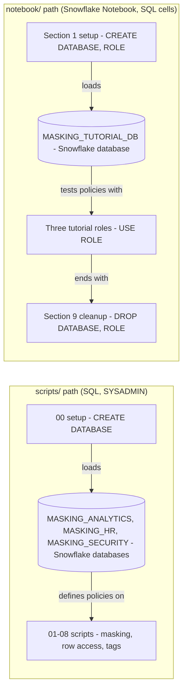

# Snowflake Data Masking and Row Access - Architecture and design rationale

*Last updated: 2026-11-07 · commit 2edefc322*

## 1. Purpose and scope

A learning tutorial on Snowflake's column-level and row-level security: dynamic data masking policies, row access
policies driven by a mapping table, tag-based masking, and ways to inspect which policies are attached. It is for
someone who knows basic Snowflake roles and wants to see each policy type on a small table.

It is not a security design for a real estate of data, and it makes no compliance claim. The tutorial mentions GDPR and
CCPA in its conclusion; nothing in the repository tests or evidences compliance. The repository does not say what kind
of account the material was run on (`TODO: verify`).

## 2. How this project was built

This project was built with Claude Code (Anthropic's AI coding assistant) in a complementary role. Elliott Fairhall is
the author and owner: the project is debugged, tested and used by him for learning and development, and the design
decisions below are explained so that they can be understood, questioned and learned from. AI assistance does not
replace that work. The repository does not record how much of each script was run or reviewed, so the document makes no
claim about that beyond the statement above.

## 3. Architecture at a glance

There are two separate ways to follow the tutorial, and they do not share objects.

The scripts path teaches one policy per file against databases that carry a `MASKING_` prefix. The notebook path is a
self-contained run: its own database and roles, a table that has policies attached, queries as three roles, and a
cleanup cell. Only the notebook demonstrates the effect of a policy end to end.

## 4. Learning path

| Order | Script                         | Teaches                                                                        | Why here                                                                             |
| ----- | ------------------------------ | ------------------------------------------------------------------------------ | ------------------------------------------------------------------------------------ |
| 00    | `00_setup_environment.sql`     | Three databases, customer, employee and sales tables with invented rows        | Gives each later policy a column or table with obviously sensitive content           |
| 01    | `01_email_masking.sql`         | A string masking policy with three outcomes: full value, partial, fully masked | Email is the clearest partial-masking example                                        |
| 02    | `02_phone_masking.sql`         | A simpler two-outcome policy keeping the last four digits                      | Repeats the pattern with less logic so the learner sees it is reusable               |
| 03    | `03_salary_masking.sql`        | A numeric policy returning a rounded value to one role                         | Introduces a different data type; policy return type must match                      |
| 04    | `04_region_row_access.sql`     | A row access policy using a lookup table                                       | Moves from columns to rows; the mapping table is the point                           |
| 05    | `05_department_row_access.sql` | A row access policy using `CURRENT_SESSION_CONTEXT`                            | The alternative to a lookup table: a session attribute                               |
| 06    | `06_mapping_table_setup.sql`   | Creating and seeding the mapping table                                         | Placed after 04 and 05 so the learner meets the policy before the data it depends on |
| 07    | `07_tag_based_masking.sql`     | An object tag and a policy attached to the tag                                 | Scaling step: classify once, protect many columns                                    |
| 08    | `08_monitoring_policies.sql`   | `SHOW`, `POLICY_REFERENCES`, `TAG_REFERENCES`, query history                   | Auditing comes last, after there is something to audit                               |

The order is columns, then rows, then tags, then audit: from the simplest control to the one that scales. Script 04
references the table that script 06 creates, so 04 cannot be tried against data until 06 has run (section 8).

## 5. Isolation, idempotency and cleanup

- **Scripts path:** namespaced (changed 2026-11-07). It uses databases named `MASKING_ANALYTICS`, `MASKING_HR` and
  `MASKING_SECURITY`, so it cannot clash with another tutorial or with a real `ANALYTICS`, `HR` or `SECURITY` database.
  `CREATE DATABASE IF NOT EXISTS` reuses an existing database of the same name, and `CREATE OR REPLACE TABLE` on
  `MASKING_ANALYTICS.MARTS.DIM_CUSTOMERS`, `MASKING_HR.PUBLIC.EMPLOYEES` and `MASKING_ANALYTICS.MARTS.FCT_SALES`
  replaces this tutorial's own tables on a re-run. No cleanup script exists.
- **Notebook path:** `masking_tutorial_db` plus three `masking_*_role` roles, all dropped in the final cell. Its first
  statement is `CREATE OR REPLACE DATABASE`, so it also replaces any database with that name.
- **Roles:** the roles the scripts test (`PII_ADMIN`, `ANALYST`, `HR_ADMIN`, `UK_ANALYST` and so on) are referenced but
  not created by any script. The notebook creates its own and grants them to `SYSADMIN`.
- **Cost:** the notebook uses a warehouse named `COMPUTE_WH` (hard-coded); the scripts name none. Data volume is a
  handful of rows.

## 6. Design rationale

### Teach masking and row access together, with a notebook as the working example

- **Why:** both are query-time policies that leave stored data unchanged (stated in the tutorial), and they are usually
  needed together. A notebook run as three roles makes the effect visible, which a policy definition alone cannot.
- **Gave up:** the scripts path alone shows no result. Policy definitions are created but the `ALTER TABLE` lines that
  attach them are commented out ("Example"), so running scripts 01 to 08 as written protects nothing.
- **Alternative not taken:** one long script that attaches and tests everything; harder to read and to break up.
- **Evidence:** the commented-out attachments are in the code; the reason is inferred.

### Role checks with `IS_ROLE_IN_SESSION` in scripts, `CURRENT_ROLE()` in the notebook

- **Why (reconstructed):** `IS_ROLE_IN_SESSION` respects role hierarchy, which is the form recommended for production;
  `CURRENT_ROLE()` is simpler to explain and predictable when a learner switches role with `USE ROLE`.
- **Gave up:** the two paths behave differently if a role inherits another. The row access policy in the scripts uses
  `CURRENT_ROLE()` against the mapping table, so it ignores inheritance even though the masking policies do not.
- **Alternative not taken:** one convention across both. The inconsistency is flagged in section 10.
- **Evidence:** inferred from the code.

### A mapping table for row access, with a session-context variant alongside

- **Why:** a table keeps the access rules as data that can be edited without redefining the policy; the session-context
  policy shows the other pattern for contrast.
- **Gave up:** the policy runs a subquery per evaluation, which is a cost a tutorial does not measure; the
  session-context policy depends on the application setting `DEPARTMENT`, which no script does.
- **Alternative not taken:** hard-coded role lists inside the policy. Simpler, but changing access means changing code.
- **Evidence:** inferred from the code.

### Tag-based masking as the scaling step

- **Why:** the tutorial states that tagging a column applies the policy automatically, which removes per-column work in
  a large estate.
- **Gave up:** in script 07 the policy bound to the tag is `email_mask`, a string policy, and the tag allows several
  values (`PHONE`, `NI_NUMBER`). Whether a policy attached to a tag applies regardless of tag value is Snowflake
  behaviour not demonstrated here, so a phone column tagged `PHONE` may be masked as an email (`TODO: verify`). The
  tag-assignment lines are commented out.
- **Alternative not taken:** one tag per data class, each with its own policy.
- **Evidence:** inferred from the code.

### Edition requirement stated, not tested

- **Why:** the tutorial's policy table lists masking and row access policies as "Enterprise+". This is documented in
  `Tutorial/DATA_MASKING_TUTORIAL.md` and has not been re-checked (`TODO: verify` against current Snowflake
  documentation).
- **Gave up:** nothing in the scripts detects an unsupported edition; a learner on a lower edition sees an error.
- **Alternative not taken:** a pre-flight check script.
- **Evidence:** documented.

### Trade-offs against production practice

| Tutorial choice                             | Production practice                                                                              |
| ------------------------------------------- | ------------------------------------------------------------------------------------------------ |
| Tutorial-prefixed database names in scripts | Dedicated tutorial database, named for the exercise                                              |
| `CREATE OR REPLACE` for policies            | Policies still attached cannot simply be replaced; use `ALTER`, or detach first (`TODO: verify`) |
| Roles tested by name in the policy body     | Mapping or tag-driven rules held outside the policy                                              |
| Policies owned by the setup role            | Dedicated security-admin role owning policies, applied by a separate role                        |

## 7. Quality and testing

No automated tests. The notebook shows the effect of masking and row access when queried as three roles; the tutorial's
results table (for example a salary of 65000) does not match the seeded rows, so it is illustrative, not captured
output. The repository does not record a verified run (`TODO: verify`).

## 8. Constraints, limitations and known gaps

- Script 04 creates a policy that reads `security.role_region_mapping`, which script 06 creates later.
- Script 06 qualifies the table as `security.role_region_mapping`, but script 00 creates a database called `SECURITY`
  with a schema `TAGS`; no script sets a database or schema context, so where the policies, mapping table and
  `email_mask` end up depends on the session (`TODO: verify`).
- Script 03 attaches to `hr.employees`, but script 00 creates `MASKING_HR.PUBLIC.EMPLOYEES`.
- The seeded mapping table lists regions (`Ireland`, `Netherlands`, `EU`, `APAC`) that the sales table does not contain.
- Script 03 returns NULL for other roles by omission; the tutorial text adds an explicit `ELSE NULL`.
- No script attaches a policy; every `ALTER` is commented out.
- Scripts path has no cleanup and no role creation; the README says `data/` holds security mapping definitions but no
  such folder exists.
- Notebook hard-codes `COMPUTE_WH`.

## 9. Running and extending

See the [README](../README.md) and the [tutorial](../Tutorial/DATA_MASKING_TUTORIAL.md). To extend safely, keep new
policy objects schema-qualified, create any role a policy names, and add the cleanup statement to the notebook's last
cell in the same change. Prefer extending the notebook, which is the only self-contained path.

## 10. Rationale (confirmed by the owner)

Confirmed by Elliott Fairhall on 2026-11-07. This reasoning was first reconstructed from the code and commit history;
the owner has since agreed it is correct, so it is now the stated rationale rather than an inference.

- The notebook is meant as the isolated, runnable version of the scripts, which is why it uses its own database and
  roles (the repository history is a single import commit and does not show which came first).
- Policy attachments are commented out in the scripts so that no one masks a real table by accident.
- Script order puts the mapping table after the policy so the policy is the lesson and the data is a detail.
- `IS_ROLE_IN_SESSION` in the scripts was chosen for hierarchy-awareness; the notebook's `CURRENT_ROLE()` was chosen for
  predictability when switching role.
- The database names `ANALYTICS`, `HR` and `SECURITY` were originally chosen for readability, on an account where they
  were free to use. They now carry a `MASKING_` prefix so the scripts cannot clash with other tutorials or real
  databases (changed 2026-11-07).
- The tag-based example is meant to show the mechanism, not a complete data classification scheme.
